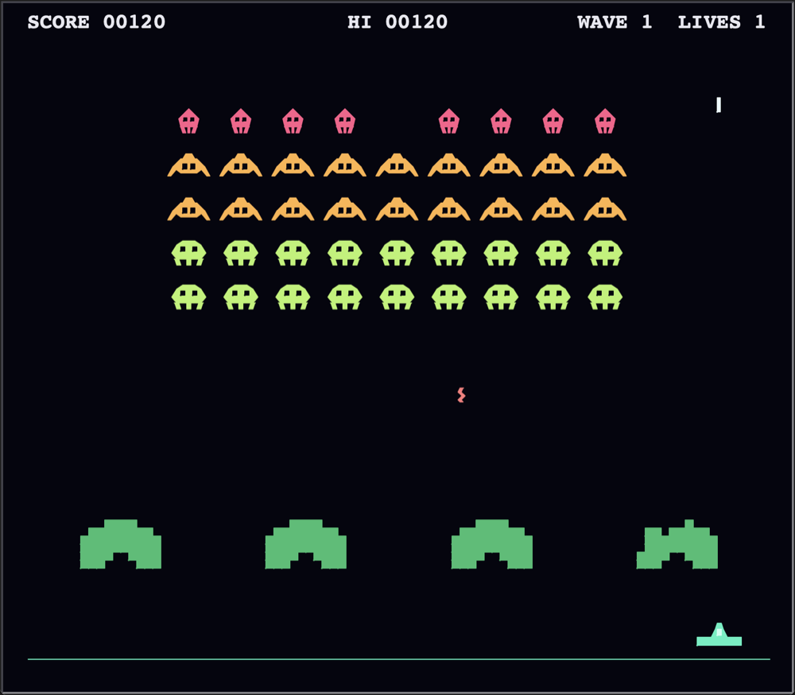

# Alien Siege

A shoot 'em up drawn with Python's `turtle` module. A fleet of aliens marches down towards your ship, you fly left and right under it and shoot them before they land. Built as part of my 100 Days of Code journey.

<p align="center">
  
</p>

## Features

- A fleet of 50 aliens in three kinds, worth 10, 20 and 30 points, that wave their legs on every step
- The fleet steps sideways and drops lower at every wall. The fewer aliens are left, the faster it moves
- Aliens shoot back from the bottom of their columns, and some of their shots aim at your ship
- Four bunkers that crumble block by block under shots from both sides and get crushed by aliens flying into them
- Your laser can shoot an alien bolt out of the air
- Three lives. Each new wave starts lower, faster and with faster alien shots
- The high score is kept between games in `highscore.txt`

## How it works

The project is split in two:

- **`game.py`** holds the rules: where everything is, what moves, what hits what. It doesn't import `turtle`, so the tests can play it without a window.
- **`main.py`** draws the game and passes the keys on. Every object is drawn as a turtle *stamp*, and a stamp is only drawn again when the object moves or changes its look. The bunkers and the fleet stand still most of the time, so a frame costs about 3 ms.

A frame comes about 60 times a second. The game moves on by the time that has really passed, so it runs at the same speed on a slow computer.

## Setup

The game uses only the Python standard library. On a Mac, use a Python from [python.org](https://www.python.org/downloads/) or Homebrew's `python-tk`, which come with Tk.

```bash
git clone https://github.com/goyalion17/alien-siege.git
cd alien-siege
python3 main.py
```

## Controls

| Key | Action |
| --- | --- |
| ← → or A D | Move |
| Space | Shoot |
| P | Pause |
| Enter | Play again after game over |
| Esc | Quit |

## Tests

```bash
python3 -m venv .venv
source .venv/bin/activate
pip install -r requirements-dev.txt
pytest
```
